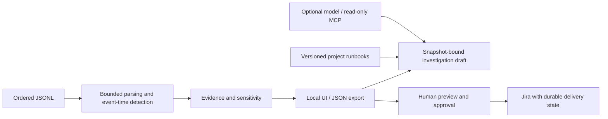

# LogFlow

A local Go tool for investigating repeated failed logins, with a free offline
investigation companion. Inspect contributing evidence, read cited guidance and
prepare a human-reviewed Jira handoff.

- **Detection:** six exact `Failed login attempt` events from one valid IP within
  ten minutes, inclusive. Threshold/window are configurable.
- **Evidence:** contributing lines/times, input identity, rejection and incomplete
  status, plus bounded sensitivity comparisons on retained trigger records.
- **Investigation:** deterministic facts and approved runbook sections by default.
  Optional local-model or bring-your-own-OpenAI-key selection of read-only tools.
- **Controls:** snapshot-bound drafts, local audit records, three read-only MCP tools,
  visible fallback and separate expiring Jira approval. No autonomous containment.

## Try it

Build the current source with Go 1.25.5+:

```sh
go build -o logflow ./cmd/logflow
./logflow
```

On Windows use `go build -o logflow.exe ./cmd/logflow`, then `.\logflow.exe`.
Choose **Try the guided demo**, open the alert and select **Draft an investigation**.
Offline mode needs no API, account or model. The detector and offline draft work
when model services are unavailable. Existing release ZIPs may predate this extension.

## Use your data

Upload ordered JSONL or use the CLI. Required fields: timestamp, level and message;
this rule also requires a valid source_ip.

```json
{"timestamp":"2026-11-06T12:00:00Z","level":"WARN","message":"Failed login attempt","source_ip":"192.0.2.10"}
```

```sh
./logflow -window 10m -threshold 6 -workers 4 input.jsonl
cat input.jsonl | ./logflow -
./logflow -replay
```

Input must be in nondecreasing event-time order. Generic ERROR messages do not
match; duplicate lines count as separate observations. Exit 2 marks incomplete
processing/configuration failures. Alerts are investigation signals, not proof
of compromise. Native EVTX/SSH ingestion is not implemented.

## Architecture



Sensitivity describes retained evidence, not a full-input rerun or confidence
score. Four synthetic replays expose slow/distributed blind spots and benign
alerting; they do not measure field detection accuracy.

## Privacy and optional AI

The UI binds to localhost with a private launcher token. No telemetry or automatic
model requests. Your data stays local in offline mode. Optional OpenAI requests
require your own API account and explicit disclosure consent; ChatGPT Plus does
not supply a general API key. Local Ollama requires your installed runtime/model.
No developer key is bundled and visitors never use the author's account.

Data lives under the OS configuration directory / LogFlow. LOGFLOW_DATA_DIR
changes the parent; LOGFLOW_NO_BROWSER=1 suppresses browser launch. Audit/draft
files contain sensitive metadata. Do not expose this single-user app publicly.
Ctrl+C stops it. Demo alerts cannot send Jira requests.

[Companion setup, MCP and safeguards](docs/ASSISTANT.md) ·
[Manual test and screenshot checklist](docs/MANUAL-ASSISTANT.md) ·
[Implementation](architecture.md)

## Verification

[Historical measured results](docs/results/README.md) belong to the November 10
revision, before this companion. They are not new model-quality or manual results.
Live model/Jira behavior and browser observations for this extension remain pending.

```sh
go test -race -count=1 ./...
go vet ./...
go build -o logflow ./cmd/logflow
python .github/scripts/smoke.py ./logflow
```

Regression checks use temporary data and local mocks. Manual results will be added
only after they are observed and reviewed. See [TESTING.md](TESTING.md).
