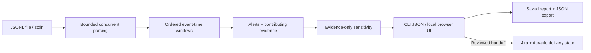

# LogFlow

A local Go app for investigating repeated failed logins in JSONL logs.
Upload a file or run the offline demo, inspect the events behind each alert,
and export the investigation. Inspect how nearby rule settings change support
from the retained evidence, and replay scenarios that expose detection blind spots.

- **Precise detection:** six `Failed login attempt` events from one valid IP
  within ten minutes, inclusive. Threshold and window are configurable.
- **Traceable results:** contributing line numbers, timestamps, normalized IPs,
  input SHA-256, and explicit rejected-record and incomplete-result reporting.
- **Portable:** browser UI and CLI in one executable; standard library only.
  White or true-black theme with a teal accent. No account needed offline.

## Try it

Download and extract a [release](https://github.com/theprideofwolves/logflow/releases),
then run `logflow` (`logflow.exe` on Windows). Choose **Try the guided demo**:
eight synthetic events produce one alert with six contributing records.

Or build from source with Go 1.25.5 or later:

```sh
go build -o logflow ./cmd/logflow
./logflow
```

## Analyze your logs

Use **Use my data** to download the example and upload ordered JSONL.
Each line needs `timestamp`, `level`, and `message`; detection also needs `source_ip`.

```json
{"timestamp":"2026-11-06T12:00:00Z","level":"WARN","message":"Failed login attempt","source_ip":"192.0.2.10"}
```

CLI output is JSON. Use `-` explicitly for stdin:

```sh
./logflow -window 10m -threshold 6 -workers 4 input.jsonl
cat input.jsonl | ./logflow -
```

Input must be in nondecreasing event-time order. Generic `ERROR` messages do not
match the rule. Duplicate lines count as separate observations. Exit `0` means
complete processing; `2` means invalid input/configuration, partial processing,
or failure. An alert is an investigation signal, not proof of compromise.

## Explain the finding

Each alert includes a threshold/window sensitivity table over its retained trigger
events. It shows evidence support, not statistical confidence or a full-input rerun.
Higher thresholds may require events outside that retained subset.

Run `./logflow -replay` (or the workspace replay link) for four deterministic
synthetic scenarios: concentrated failures, slow attempts, distributed sources,
and benign repeated failures. Two evade the default rule; benign failures can
also trigger it. These are behavioral demonstrations, not field accuracy metrics.

## Architecture



The UI binds only to localhost with a private per-launch token. Latest results
stay in the OS configuration directory under `LogFlow`; export before replacing
them. `LOGFLOW_DATA_DIR` overrides the **parent** directory.
`LOGFLOW_NO_BROWSER=1` suppresses browser opening. Ctrl+C stops the app.

No telemetry or background uploads. Demo alerts cannot create Jira tickets.
Uncertain Jira creates block retries until reconciled; credentials are not saved.

[Implementation and limits](architecture.md) · [Tests and quick manual checklist](TESTING.md)

## Measured results

The 2026-11-10 local run passed **47 top-level tests + 55 subtests** with
**77.7% statement coverage**. In-memory processing of 100,000 synthetic records
across 1,000 IPs measured a median **635,075 records/s** with four workers.
This excludes disk I/O, JSON export and UI; it is not field detection accuracy.

[Reproducible results](docs/results/README.md) include race-test/coverage outcomes,
functional evidence and synthetic processing benchmarks.
[Functionality matrix](docs/FUNCTIONALITY.md) distinguishes automated checks,
mocked Jira integration and unverified manual behavior.

## Development checks

```sh
go test -race -count=1 ./...
go vet ./...
go build -o logflow ./cmd/logflow
python .github/scripts/smoke.py ./logflow
```

Tests use temporary data and local Jira mocks, without paid services or credentials.
