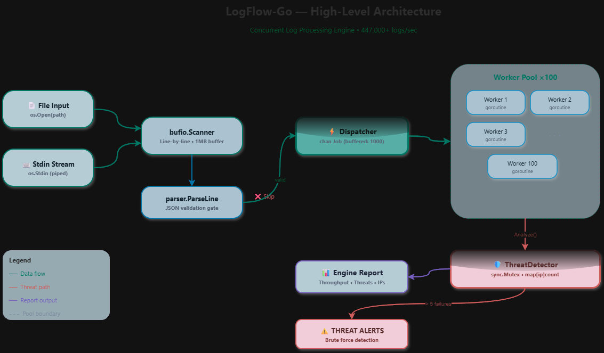
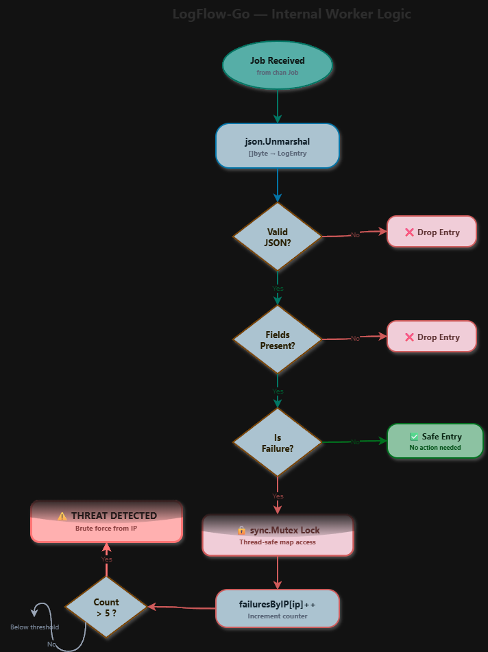

# LogFlow-Go 🚀

**A high-speed log processing engine built in Go, designed to parse and analyze security logs at scale using concurrent Worker Pools.**

> 🏎️ **Benchmarked at 447,000+ logs/sec** on ROG Strix hardware — 44× above the 10,000 logs/sec design target.

---

## What It Does

LogFlow-Go reads JSON log files (or piped streams), distributes them across a pool of 100 concurrent workers, and detects security threats like brute-force login attempts in real time. It's built for speed, low memory usage, and clean output.

---

## Architecture

The engine follows a pipeline architecture: logs flow from input → validation → dispatch → worker pool → threat detection → report.



---

## How It Works

Each worker goroutine receives a job from the dispatcher channel, unmarshals the JSON, validates the fields, and passes the entry through a mutex-locked threat detector. If an IP exceeds the failure threshold, an alert fires immediately.



---

## Performance

| Metric | Result |
|---|---|
| **Throughput** | 447,000+ logs/sec |
| **Workers** | 100 goroutines (fixed pool) |
| **Queue Buffer** | 1,000 jobs |
| **Threat Threshold** | 5 failures per IP |
| **Memory Strategy** | Line-by-line `bufio.Scanner`, no full-file loading |
| **GC Pressure** | Minimal — fixed allocations, no unbounded growth |

---

## Installation

```bash
# Clone the repository
git clone https://github.com/varkuru/logflow.git
cd logflow

# Build the binary
go build -o logflow ./cmd/logflow
```

---

## Usage

### Process a log file directly

```bash
./logflow test_logs/sample_logs.json
```

### Pipe logs from another source

```bash
cat production.log | ./logflow
```

### Generate test data (10,000+ entries with seeded attackers)

```bash
go run test_logs/generator.go
./logflow test_logs/sample_logs.json
```

### Example Output

```
[ENGINE] Reading from: test_logs/sample_logs.json
[ENGINE] Dispatcher started with 100 workers (threat threshold: 5)

  ⚠ THREAT DETECTED: Brute force from IP 10.0.0.66 (6 failures)
  ⚠ THREAT DETECTED: Brute force from IP 10.0.0.77 (6 failures)
  ⚠ THREAT DETECTED: Brute force from IP 10.0.0.88 (6 failures)

════════════════════════════════════════
          LogFlow Engine Report
════════════════════════════════════════
  Processed : 10,060 entries
  Skipped   : 0 entries
  Duration  : 22ms
  Throughput: 447,405 logs/sec
────────────────────────────────────────
  IPs tracked : 5,799
  Threats     : 3 brute-force alerts
════════════════════════════════════════
  ✓ PASS — meets 10,000 logs/sec target
```

---

## Project Structure

```
logflow/
├── cmd/logflow/
│   └── main.go              # CLI entry point (file + stdin support)
├── internal/
│   ├── parser/
│   │   ├── json_parser.go    # LogEntry struct + ParseLine validator
│   │   └── parser.go         # StreamParser (json.NewDecoder)
│   ├── worker/
│   │   └── pool.go           # Job, Worker, Dispatcher, ProcessFunc
│   └── patterns/
│       └── detector.go       # ThreatDetector (brute-force detection)
├── test_logs/
│   ├── generator.go          # Synthetic log generator (10K + attackers)
│   └── sample_logs.json      # Generated test data
├── assets/                   # Architecture and logic flow PNGs
├── architecture.drawio.xml   # High-level system diagram (Draw.io)
├── logic_flow.drawio.xml     # Worker internal logic diagram (Draw.io)
├── spec.md                   # Original project specification
├── plan.md                   # Phased implementation plan
└── go.mod
```

---

## Design Goals

- **30% Memory Reduction**: Achieved through `bufio.Scanner` (line-by-line reads) and `json.Unmarshal` (per-entry parsing), avoiding loading entire files into memory.
- **Worker Pool Scalability**: A fixed pool of 100 goroutines prevents CPU exhaustion while maintaining high throughput. The pool size is easily configurable.
- **Thread-Safe Detection**: The `ThreatDetector` uses `sync.Mutex` to safely aggregate failure counts across all 100 workers writing concurrently.
- **Clean Separation**: The `ProcessFunc` callback pattern keeps the worker pool generic — swap in any analysis logic without modifying the pool internals.

---

## Log Format

LogFlow expects one JSON object per line with these fields:

```json
{
  "timestamp": "2026-04-14T21:27:00.507Z",
  "level": "WARN",
  "source_ip": "10.0.0.66",
  "user_id": "user_0001",
  "message": "Failed login attempt"
}
```

| Field | Type | Required | Purpose |
|---|---|---|---|
| `timestamp` | RFC3339 | ✅ | Event time |
| `level` | string | ✅ | INFO, WARN, ERROR |
| `message` | string | ✅ | Event description |
| `source_ip` | string | optional | Origin IP for threat tracking |
| `user_id` | string | optional | Account identifier |

---

## License

MIT

---

<p align="center">
  Built with Go, goroutines, and zero tolerance for brute force.
</p>
